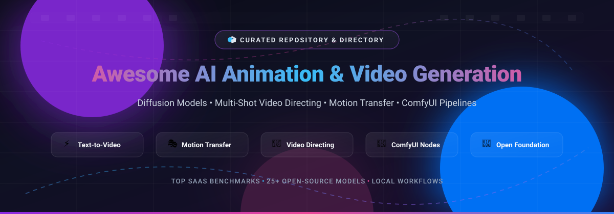

# 🎬 Awesome AI Animation & Video Generation

  

  
  
  
  
  
  

---

## 🌟 Top AI Animation & Video Generation Ecosystem

**Curated List of SaaS Products & Open-Source GitHub Projects**  
*Focused on Text-to-Video, Image-to-Video Diffusion, AI Storyboarding & Video Directing, Character Motion Transfer, and Local ComfyUI Video Pipelines.*

📅 **Last updated: November 2026**

This repository is an SEO-optimized knowledge hub tracking notable **generative AI video SaaS platforms** and **open-weight video foundation models**. From text-to-video diffusion transformer architectures (DiT) and multi-shot storyboard directors to human motion transfer, anime restyling, frame interpolation, and consumer-GPU ComfyUI nodes, discover the tools transforming modern AI filmmaking, digital animation, VFX, and creative production.

✨ **Key Highlights & Taxonomy:**
- 🎥 **SaaS Cloud Leaders**: Runway (Gen-3/Gen-4), Luma Dream Machine, Kling AI, Hailuo MiniMax, Pika Labs, Viggle AI, Leonardo.Ai, Haiper, Kaiber, and DomoAI.
- 🚀 **Open-Source Foundations**: Wan2.1, HunyuanVideo, CogVideoX, LTX-Video, Mochi 1, Open-Sora, and Stable Video Diffusion.
- 🎭 **Motion Transfer & Pose Retargeting**: LivePortrait, AnimateAnyone, MimicMotion, DWPose, and AnimatedDrawings.
- 🧩 **Local ComfyUI & Modular Workflows**: ComfyUI-AnimateDiff-Evolved, ComfyUI-VideoHelperSuite, IPAdapter-Plus, ComfyUI-GGUF, and ComfyUI-WanVideoWrapper.
- ⚡ **Frame Interpolation & Code-Driven Video**: RIFE, FILM, Remotion, and Manim.

---

## 📑 Table of Contents

- [📊 Sector Overview & Market Dynamics](#-sector-overview--market-dynamics)
- [☁️ SaaS / Hosted Platforms](#️-saas--hosted-platforms)
- [💻 Open-Source GitHub Projects](#-open-source-github-projects)
  - [🏆 Open-Source Repositories (Ranked by Stars)](#-open-source-repositories-ranked-by-stars)
- [⭐ Star History](#-star-history)
- [💖 Support](#-support)
- [🤝 How to Contribute](#-how-to-contribute)
- [📜 Disclaimer](#-disclaimer)

---

## 📊 Sector Overview & Market Dynamics

The global Generative AI in Video and Animation market is estimated at **$1.8 billion to $2.4 billion in 2026**, growing at a rapid CAGR of over 36% and projected to surpass **$15 billion by 2032**. 

The sector exhibits a **moderately fragmented and rapidly contested dynamic** rather than an entrenched "winner-take-all" monopoly:
- **Foundational Compute & Cloud Moats**: Hyperscalers and frontier research labs (OpenAI Sora, Google Veo, Kuaishou Kling AI, and MiniMax) dominate raw generative model scale and multi-shot coherent video synthesis.
- **Workflow & Creative Specialization**: A vibrant layer of vertical SaaS platforms (Runway for VFX & filmmaker suites, Viggle AI for character motion transfer, DomoAI for anime restyling, and Kaiber for audio-reactive music videos) captures distinct creator segments with dedicated workflow tooling.
- **Local & Open-Source Renaissance**: In parallel, high-performing open-weight diffusion transformer architectures (such as Wan2.1, HunyuanVideo, and LTX-Video) combined with modular ComfyUI pipelines give indie creators, animators, and VFX studios decentralized, private, and customizable production environments.

---

## ☁️ SaaS / Hosted Platforms

| Platform | Description | Size (Valuation / Revenue) | Pricing | Free Tier Limits |
| :--- | :--- | :--- | :--- | :--- |
| **[OpenAI (Sora)](https://sora.com)** | 🌌 Frontier generative video model producing complex cinematic scenes and high-fidelity motion. | $852B Valuation ($1.25T target; $3.7B+ Revenue) | $20/month (via ChatGPT Plus; Pro tier at $200/month) | Free tier discontinued; previously limited access (trial quota up to 30 watermarked clips/mo). Paid tiers provide metered priority credits. |
| **[Kling AI](https://klingai.com)** (Kuaishou) | 🎥 High-resolution generative video platform supporting 1080p motion synthesis, camera controls, and lip-sync. | $18B Valuation ($240M ARR; parent Kuaishou ~$25B Market Cap) | $10/month (or $6.60/month billed annually for Standard Plan, 660 credits) | 66 credits daily (refreshes every 24 hours, non-accumulating; ~6 video generations/day, 720p with watermark, non-commercial). |
| **[Hailuo AI](https://hailuoai.video)** (MiniMax) | ⚡ Cloud video foundation model platform generating hyper-realistic motion physics, camera moves, and cinematic quality. | $5.5B–$8B Market Cap / Valuation ($116.6M H1 2026 Revenue) | $14.99/month (or $8.40/month billed annually for Standard Plan, 1,000 credits) | 100–200 welcome credits on initial sign-up (valid for 3 days; ~2–4 videos, 768p with watermark); daily bonus drops (50 credits/day when active). |
| **[Runway (Gen-3 / Gen-4)](https://runwayml.com)** | 🎬 Industry-leading generative video & VFX suite with Motion Brush, Act-One performance capture, and camera choreography. | $5.3B Valuation ($200M ARR) | $15/month ($12/month billed annually for Standard Plan, 625 credits/mo) | 125 credits one-time free exploration grant upon sign-up (does not renew monthly; watermarked 720p exports, 5 GB storage). |
| **[Luma Dream Machine](https://lumalabs.ai)** | 🚀 High-speed cloud AI video platform producing physically coherent animations with keyframing and camera presets. | $4.0B Valuation ($50M+ Revenue) | $9.99/month (Lite Plan, ~3,200 credits/mo; Plus Plan at $30/mo for commercial rights) | 80 credits daily (resets every 24 hours, non-accumulating; personal non-commercial use only, draft/720p watermarked output). |
| **[Pika Labs (Pika Art)](https://pika.art)** | 🎨 Creative AI video platform featuring Pikaffects, video expansion, regional inpainting, lip-syncing, and sound effects. | $470M–$700M Valuation ($135M raised) | $10/month ($8/month billed annually for Starter Plan, 600 credits/mo) | Free tier ($0/mo) includes interface access with 0 recurring monthly credits (video generation requires credit packs starting at $5 or paid subscription; watermark-free, non-commercial). |
| **[Viggle AI](https://viggle.ai)** | 🕺 Controllable character animation platform powered by JST-1 video-3D foundation model for motion transfer and choreography. | $100M–$250M Est. Valuation ($26M raised) | $9.99/month ($7.99/month billed annually for Pro Plan, 80 credits/mo) | 5 credits/generations per day (resets daily, 1 generation at a time, 1-min upload cap, watermarked outputs, 7-day asset storage). |
| **[Leonardo.Ai (Motion)](https://leonardo.ai)** | 🖼️ Generative art and animation suite to animate illustrations and concept art with adjustable motion strength and camera tools. | $80M+ Acquisition Valuation (Acquired by Canva) | $12/month ($10/month billed annually for Essential Plan, 8,500 fast tokens/mo) | 150 fast tokens daily (resets every 24 hours, non-accumulating; public creations, standard generation queue). |
| **[Haiper](https://haiper.ai)** | 👁️ Perceptual foundation-model video creation platform providing text-to-video, image-to-video, repainting, and motion templates. | $50M–$100M Est. Valuation ($19.2M raised, ~$2M ARR) | $9.99/month ($8/month billed annually for Explorer Plan, 500 credits/mo) | ~10 free video generations per day (refreshes daily at midnight UTC, non-accumulating, 720p resolution, watermarked, non-commercial). |
| **[Kaiber](https://kaiber.ai)** | 🎵 Audio-reactive AI animation and music-video studio offering style transformations, choreography, and canvas workflows. | Undisclosed ($10M+ raised, ~$2.6M ARR) | $10/month ($8/month billed annually for Starter Plan, 500 credits/mo) | 5-day trial for $5 (includes 500 credits and full feature access, auto-renews to Creator plan at $29/mo unless cancelled; no perpetual free tier). |
| **[DomoAI](https://domoai.app)** | ⛩️ Cloud AI video-to-video restyling platform converting live-action footage into anime, comic, 3D cartoon, and stylized motion. | Private / Bootstrapped (Independent creator platform) | $9.99/month ($6.99/month billed annually for Basic Plan, 500 credits/mo) | 15 credits one-time free trial on sign-up (enough for 1 test style transfer/video generation; watermarked, non-commercial). |

---

## 💻 Open-Source GitHub Projects

An expanded directory of open-source video models, motion retargeting pipelines, automated storyboard directors, ComfyUI extension nodes, and frame interpolation libraries.

### 🏆 Open-Source Repositories (Ranked by Stars)

- 💻 **[remotion-dev/remotion](https://github.com/remotion-dev/remotion)**   
  Make videos programmatically using React, enabling dynamic text, programmatic animations, and cloud-rendered video pipelines with web technologies.

- 📐 **[ManimCommunity/manim](https://github.com/ManimCommunity/manim)**   
  Community-maintained Python framework for programmatic mathematical animations and educational video explanations.

- 🌌 **[hpcaitech/Open-Sora](https://github.com/hpcaitech/Open-Sora)**   
  Open-source (`Apache-2.0`) video generation ecosystem democratizing efficient large-scale spatial-temporal Diffusion Transformer training and inference.

- 🎞️ **[Stability-AI/generative-models](https://github.com/Stability-AI/generative-models)**   
  Official repository containing **Stable Video Diffusion** (`SVD` / `SVD-XT`), the foundational open-weight image-to-video latent diffusion models turning still images into temporal sequences.

- 🎯 **[facebookresearch/sam2](https://github.com/facebookresearch/sam2)**   
  Segment Anything in Images and Videos (SAM 2) from Meta FAIR, enabling real-time promptable visual object rotoscoping, tracking, and video mask extraction.

- 👤 **[KlingAIResearch/LivePortrait](https://github.com/KlingAIResearch/LivePortrait)**   
  High-fidelity portrait and anime character animation engine featuring seamless stitching, eye/lip retargeting, and zero-shot expressive head pose transfer.

- 🎬 **[Wan-Video/Wan2.1](https://github.com/Wan-Video/Wan2.1)**   
  Flagship open-source (`Apache-2.0`) video foundation model suite from Alibaba supporting text-to-video, image-to-video, video editing, and text rendering on consumer and enterprise GPUs.

- 📦 **[lllyasviel/FramePack](https://github.com/lllyasviel/FramePack)**   
  Memory-efficient open-source (`Apache-2.0`) autoregressive next-frame-prediction video diffusion architecture enabling long-horizon 30 fps video generation on 6GB–12GB consumer GPUs.

- 🕺 **[HumanAIGC/AnimateAnyone](https://github.com/HumanAIGC/AnimateAnyone)**   
  Seminal open-source pose-guided character animation framework preserving intricate appearance textures across continuous human dance and athletic movement.

- 🧠 **[THUDM/CogVideo](https://github.com/THUDM/CogVideo)**   
  Open-source (`Apache-2.0`) Diffusion Transformer video generation family (**CogVideoX**) from Tsinghua/Zhipu AI featuring 3D causal VAEs for smooth, temporally consistent text- and image-to-video.

- 🎨 **[facebookresearch/AnimatedDrawings](https://github.com/facebookresearch/AnimatedDrawings)**   
  Meta FAIR's open-source system bringing hand-drawn stick figures, cartoon characters, and children's drawings to life with rigged skeletal animations.

- 📽️ **[Tencent-Hunyuan/HunyuanVideo](https://github.com/Tencent-Hunyuan/HunyuanVideo)**   
  Large-scale open-source video foundation model delivering cinema-grade motion coherence, realistic physics, dual-stream DiT architectures, and native ComfyUI integration.

- 🪄 **[guoyww/AnimateDiff](https://github.com/guoyww/AnimateDiff)**   
  Iconic open-source (`Apache-2.0`) plug-and-play motion module framework that animates personalized Stable Diffusion / SDXL checkpoints with MotionLoRA camera choreography.

- ⚡ **[Lightricks/LTX-Video](https://github.com/Lightricks/LTX-Video)**   
  Real-time open-source DiT-based video generation model capable of synthesizing high-resolution 30 fps video clips faster than real time on local GPUs.

- 💃 **[open-mmlab/mmpose](https://github.com/open-mmlab/mmpose)**   
  OpenMMLab's comprehensive pose estimation and tracking toolbox used across AI animation pipelines for 2D/3D human body, hand, and facial keypoint extraction.

- 🎥 **[SkyworkAI/SkyReels-V2](https://github.com/SkyworkAI/SkyReels-V2)**   
  Open-source infinite-length film-grade video generation model combining diffusion forcing, reinforcement learning, and multi-shot cinematic directing workflows.

- 🗣️ **[TMElyralab/MuseTalk](https://github.com/TMElyralab/MuseTalk)**   
  Real-time audio-driven talking-head generation engine supporting multi-language lip-syncing at 30+ fps with complete facial expression coherence.

- 🥢 **[kaomei/stickman-video-director](https://github.com/kaomei/stickman-video-director)**   
  Open-source AI video directing and stickman animation workflow tool designed for orchestrating character poses, scene pacing, and automated animated video storytelling.

- 🧩 **[kijai/ComfyUI-WanVideoWrapper](https://github.com/kijai/ComfyUI-WanVideoWrapper)**   
  Comprehensive ComfyUI node integration for Alibaba's Wan2.1 video model with text-to-video, image-to-video, and memory-saving offloading.

- 🖼️ **[cubiq/ComfyUI_IPAdapter_plus](https://github.com/cubiq/ComfyUI_IPAdapter_plus)**   
  Enhanced ComfyUI node implementation of IP-Adapter, providing reference image character conditioning and composition control across video diffusion runs.

- 🎨 **[Doubiiu/ToonCrafter](https://github.com/Doubiiu/ToonCrafter)**   
  Generative cartoon interpolation framework that synthesizes fluid intermediate anime frames between two sparse keyframe drawings.

- 🏃 **[hzwer/ECCV2022-RIFE](https://github.com/hzwer/ECCV2022-RIFE)**   
  Real-Time Intermediate Flow Estimation (RIFE) for optical-flow frame interpolation, upscaling low-framerate AI animations to 60 fps smoothly.

- 🎛️ **[Fannovel16/comfyui_controlnet_aux](https://github.com/Fannovel16/comfyui_controlnet_aux)**   
  Essential auxiliary preprocessors (OpenPose, Depth, LineArt, Canny, DWPose) for driving ControlNet motion consistency in local video generations.

- 📉 **[city96/ComfyUI-GGUF](https://github.com/city96/ComfyUI-GGUF)**   
  ComfyUI custom nodes for quantized GGUF weights, enabling high-parameter video foundation models to run on 8GB–16GB consumer VRAM.

- 🎙️ **[fudan-generative-vision/hallo2](https://github.com/fudan-generative-vision/hallo2)**   
  Long-duration audio-driven talking portrait animation with 4K resolution upscaling, modular emotion dynamics, and audio-visual synchronization.

- 🔮 **[genmoai/mochi](https://github.com/genmoai/mochi)**   
  Open-source (`Apache-2.0`) Asymmetric Diffusion Transformer (AsymmDiT) video generation model engineered for photorealistic human motion and prompt fidelity.

- 🌀 **[Kosinkadink/ComfyUI-AnimateDiff-Evolved](https://github.com/Kosinkadink/ComfyUI-AnimateDiff-Evolved)**   
  Advanced ComfyUI node suite enabling infinite-length context windows, prompt traveling, ControlNet/IPAdapter motion scheduling, and latent interpolation.

- 🎭 **[MooreThreads/Moore-AnimateAnyone](https://github.com/MooreThreads/Moore-AnimateAnyone)**   
  Open-source (`Apache-2.0`) pose-driven character animation pipeline transferring full-body dance and acting sequences onto reference character illustrations.

- 📽️ **[google-research/frame-interpolation](https://github.com/google-research/frame-interpolation)**   
  Google Research's Frame Interpolation for Large Motion (FILM), synthesizing high-quality intermediate video frames across wide temporal disparities.

- 🦴 **[IDEA-Research/DWPose](https://github.com/IDEA-Research/DWPose)**   
  State-of-the-art 2D whole-body pose estimation (body, face, hands) delivering noise-free skeletal driving signals for character animation.

- 💃 **[Tencent/MimicMotion](https://github.com/Tencent/MimicMotion)**   
  High-resolution human motion transfer framework using confidence-aware pose guidance to animate any character image cleanly from driving videos.

- 🧩 **[kijai/ComfyUI-HunyuanVideoWrapper](https://github.com/kijai/ComfyUI-HunyuanVideoWrapper)**   
  Custom ComfyUI integration for Tencent's HunyuanVideo supporting block offloading, prompt scheduling, and VAE optimizations.

- 🛠️ **[Kosinkadink/ComfyUI-VideoHelperSuite](https://github.com/Kosinkadink/ComfyUI-VideoHelperSuite)**   
  ComfyUI toolkit for loading, batching, frame-interpolating, audio-syncing, and encoding high-bitrate MP4/WebM/GIF animations.

---

## ⭐ Star History

---

## 💖 Support

If you find this curated ecosystem list helpful for your generative AI filmmaking, animation workflows, or local ComfyUI pipelines:

- ⭐ **Star this repository** to show support and track ongoing updates!
- 🍴 **Fork the project** to experiment with custom pipelines or contribute new models.
- 📢 **Share it** with fellow animators, VFX artists, and AI engineers.
- ☕ **Support the creator**: If you'd like to sponsor continued maintenance and community research, consider [sponsoring on GitHub](https://github.com/sponsors/ishandutta2007) or buying a coffee on the **[Sponsor Dashboard](https://github.com/sponsors/ishandutta2007)**!

---

## 🤝 How to Contribute

Contributions are warmly encouraged! To propose a new open-source project or SaaS platform:

1. 🍴 Fork the repository.
2. 🌿 Create a new feature branch (`git checkout -b feature/add-new-tool`).
3. 📝 Add your entry with factual descriptions, active links, pricing/star badges, and proper categorization.
4. 🚀 Open a Pull Request with a brief explanation.

---

## 📜 Disclaimer

*This list is curated for research, educational, and workflow discovery purposes. Trademarks, product names, logos, and brands belong to their respective owners. Pricing plans, credit allocations, and valuation metrics reflect the best available public information as of November 2026 and are subject to change.*
